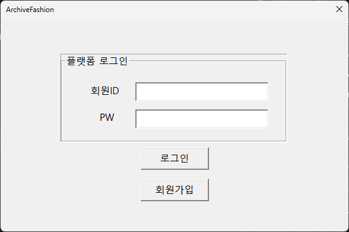
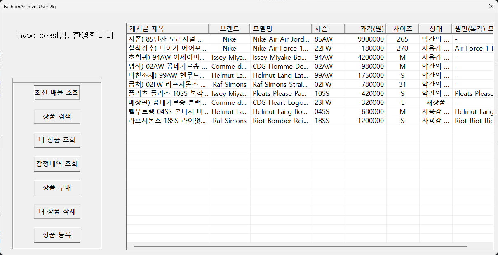
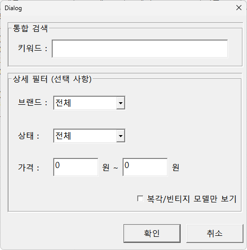
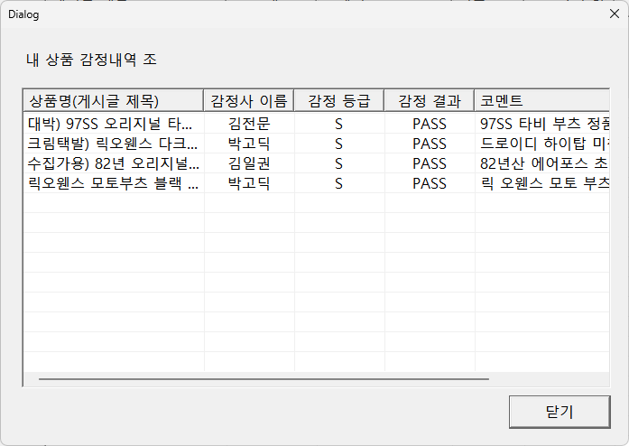
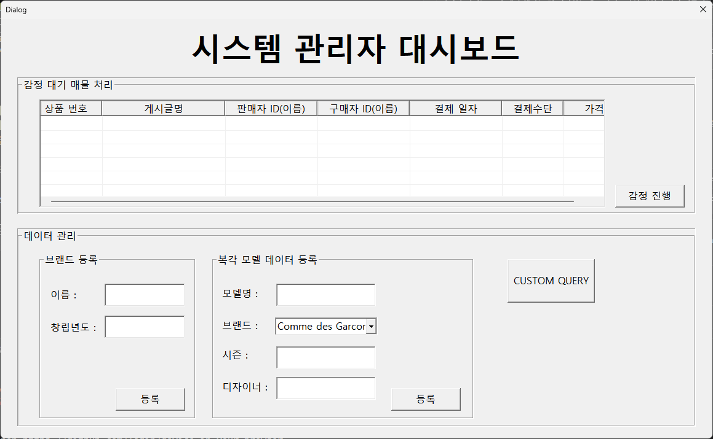
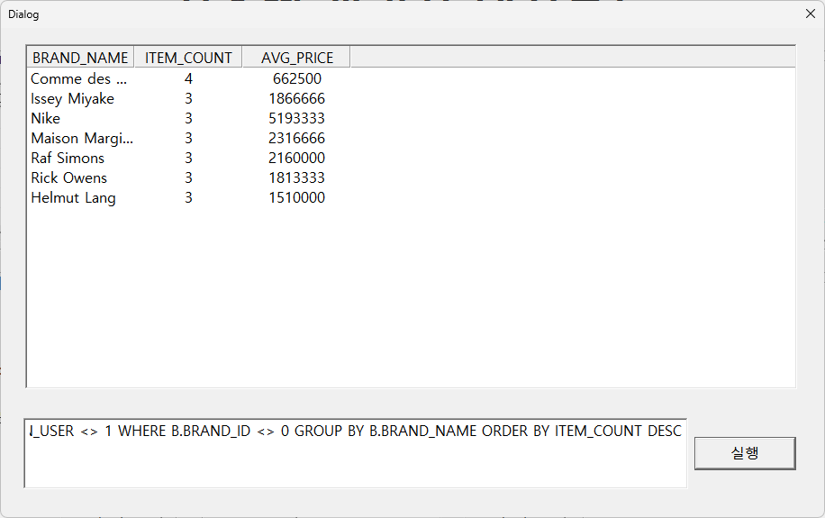
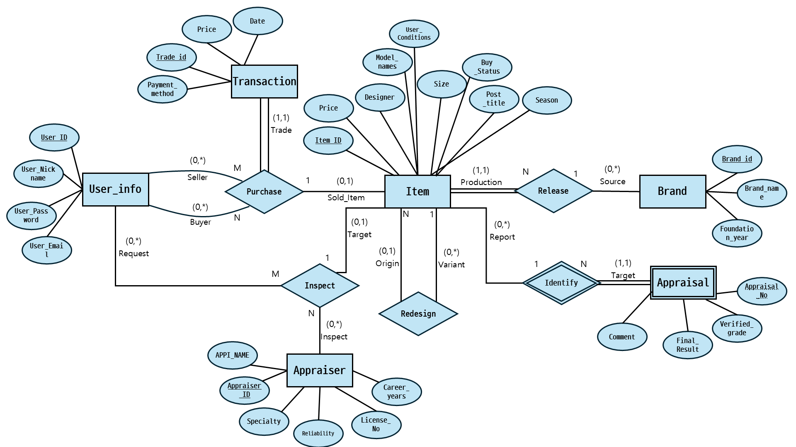

# 아카이브 패션 중고거래 플랫폼 (Archive Fashion Market)

아카이브 패션(빈티지 디자이너 의류) 중고거래를 위한 데이터베이스와 Windows 데스크톱 클라이언트입니다.
**세종대학교 2026-1학기 데이터베이스 과목 미니프로젝트**로 진행했습니다.

- **DB 설계**: ER 다이어그램 작성, 관계형 스키마 변환, 제약조건 설계
- **구현**: SQL Server 스키마와 샘플 데이터, MFC(C++) 클라이언트에서 ODBC로 연동

## 실행 화면

| 로그인 | 최신 매물 조회 |
| --- | --- |
|  |  |

| 상품 검색 (필터) | 내 상품 감정 내역 |
| --- | --- |
|  |  |

| 관리자 대시보드 | 관리자 Custom Query |
| --- | --- |
|  |  |

## 주요 기능

**일반 사용자**
- 회원가입 (이메일/닉네임 중복 확인), 로그인, 탈퇴 계정 로그인 차단
- 최신 매물 조회, 키워드·브랜드·상태·가격 범위·복각 모델 여부로 상품 검색
- 상품 등록 (복각 제품은 원형 모델 지정), 내 상품 조회와 삭제
- 상품 구매: 결제하면 상품이 `감정대기` 상태가 되고 거래 내역이 생성됨
- 내 상품의 감정 결과 조회

**관리자**
- 감정 대기 매물 처리: `PASS`면 판매 완료, `FAIL`이면 거래를 취소하고 다시 판매중으로 전환
- 브랜드 등록, 복각 원형 모델(레퍼런스) 등록
- 임의의 SQL을 실행하고 결과를 표로 보는 Custom Query

## 데이터베이스 설계



| 테이블 | 설명 |
| --- | --- |
| `USER_INFO` | 회원. `USER_ID = 1`은 관리자, `IS_DELETED`로 탈퇴를 논리 삭제(soft delete) |
| `BRAND` | 브랜드. `BRAND_ID = 0`은 삭제된 브랜드를 대신하는 기본값 |
| `ITEM` | 판매 상품. `ORIGINAL_MODEL`로 복각 제품과 원형 모델을 잇는 자기 참조 관계 |
| `APPRAISAL` | 감정 내역. `ITEM`에 종속된 약한 개체로 `(ITEM_ID, APPRAISAL_NO)` 복합키 사용, 불합격 후 재감정 이력 보관 |
| `APPRAISER` | 감정사. 주력 브랜드, 경력, 신뢰도 관리 |
| `TRANSACTIONS` | 거래 내역. 상품당 거래는 한 번이므로 `ITEM_ID`에 `UNIQUE` 제약 |

설계하면서 고민한 부분:
- **삭제 정책**: 회원은 거래 기록을 보존해야 해서 물리 삭제 대신 `IS_DELETED` 플래그를 사용했습니다. 브랜드가 삭제되면 상품은 `ON DELETE SET DEFAULT`로 `BRAND_ID = 0`에 연결됩니다.
- **다중 CASCADE 경로 회피**: SQL Server는 한 테이블로 이어지는 CASCADE 경로가 여러 개면 테이블을 만들 수 없습니다. 그래서 `TRANSACTIONS`의 판매자/구매자 FK와 `ITEM`의 자기 참조 FK는 `NO ACTION`으로 두고, 필요한 처리는 애플리케이션에서 하도록 했습니다.
- **도메인 제약**: 가격 `CHECK (PRICE > 0)`, 감정사 신뢰도 `0~100`, 상태 값 `CHECK (... IN (...))`

자세한 설계 과정은 [보고서(PDF)](docs/report.pdf)에, 화면별 사용법은 [사용자 매뉴얼(PDF)](docs/manual.pdf)에 정리했습니다.

## 기술 스택

- **Database**: Microsoft SQL Server (T-SQL), Korean_Wansung_CI_AS 데이터 정렬
- **Client**: C++ / MFC (대화 상자 기반), Visual Studio 2022 (v143)
- **연동**: ODBC API (`SQLConnect`, `SQLExecDirect`, `SQLBindCol`, `SQLFetch`)

## 프로젝트 구조

```
archive-market-db/
├── DB_Miniproject_MFC.sln        # Visual Studio 솔루션
├── src/DB_Miniproject_MFC/       # MFC 클라이언트 소스
│   ├── DBManager.*               #   ODBC 연결 관리
│   ├── CLoginDlg.* CRegisterDlg.*        #   로그인, 회원가입
│   ├── CUserMainDlg.* CUser*Dlg.*        #   사용자 화면 (조회, 검색, 등록, 구매, 감정 내역)
│   ├── CAdminMainDlg.* CAdmin*Dlg.*      #   관리자 화면 (감정 처리, 데이터 등록)
│   ├── CCustomQueryDlg.*         #   Custom Query
│   └── DBMiniprojectMFC.rc       #   화면(대화 상자) 리소스
├── database/
│   └── init.sql                  # 테이블 생성 + 샘플 데이터
└── docs/
    ├── erd.png                   # ER 다이어그램
    ├── report.pdf                # 프로젝트 보고서
    ├── manual.pdf                # 사용자 매뉴얼
    └── screenshots/
```

## 실행 방법

**요구 사항**: Windows, SQL Server 2016 이상, Visual Studio 2022 (*C++를 사용한 데스크톱 개발* + *MFC* 구성 요소)

1. **DB 생성**: SQL Server Management Studio에서 데이터베이스를 하나 만들고 [`database/init.sql`](database/init.sql)을 실행합니다.
2. **ODBC 데이터 원본 등록**: *ODBC 데이터 원본(64비트)* → 사용자 DSN 추가
   - 드라이버: `SQL Server`
   - 이름: `DB01_Server`
   - 기본 데이터베이스: 1번에서 만든 DB
3. **접속 계정 확인**: 클라이언트는 [`DBManager.cpp`](src/DB_Miniproject_MFC/DBManager.cpp)에 적힌 SQL Server 계정으로 접속합니다. 본인 환경에 맞게 수정하세요.
4. **빌드 및 실행**: `DB_Miniproject_MFC.sln`을 열고 `Release | x64`로 빌드한 뒤 실행합니다.

샘플 관리자 계정은 `admin@admin.com` / `1q2w3e4r!`입니다. 일반 사용자 계정은 `init.sql`의 `USER_INFO` 데이터를 참고하세요.

## 한계

수업 과제로 DB 설계와 연동에 집중했기 때문에, 실서비스 수준의 보안 처리는 하지 않았습니다.
- 쿼리를 문자열로 이어 붙여 실행해서 SQL 인젝션에 취약합니다. 실서비스라면 `SQLPrepare`와 `SQLBindParameter`로 파라미터를 바인딩해야 합니다.
- 비밀번호를 평문으로 저장합니다.
- DB 접속 정보가 코드에 포함되어 있습니다.
